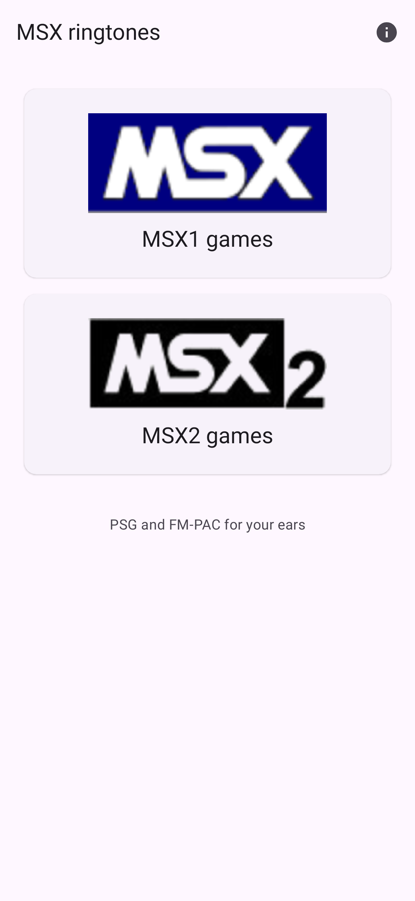
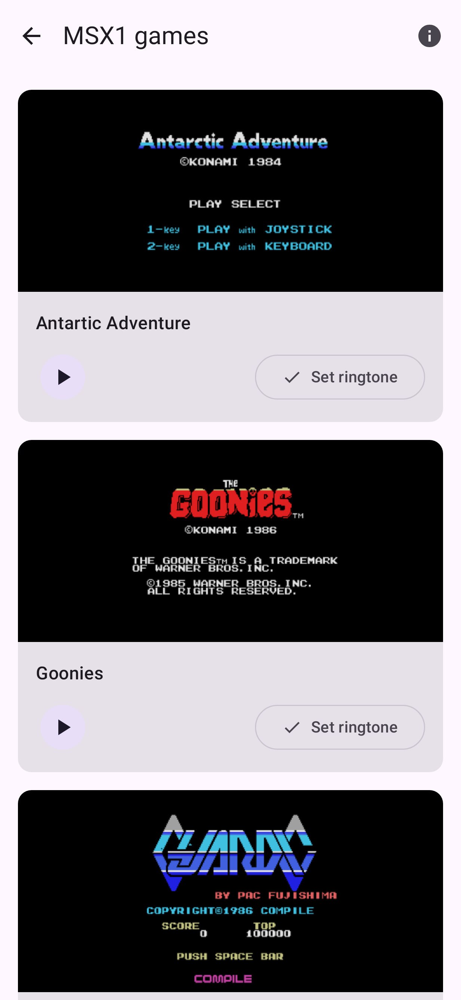
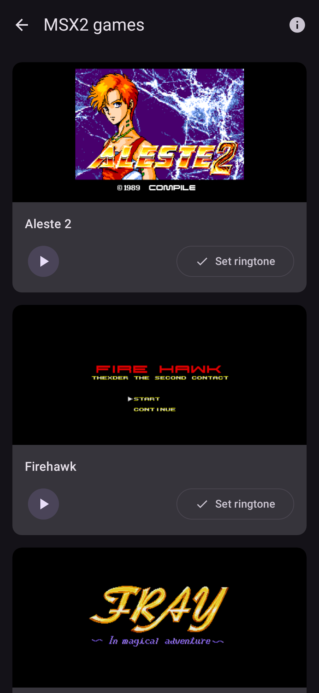
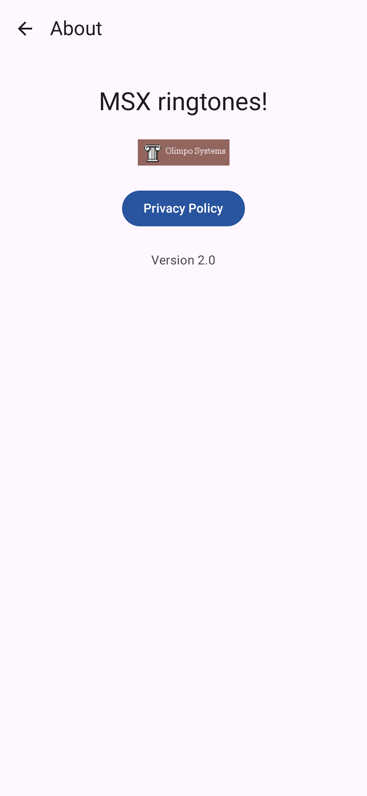
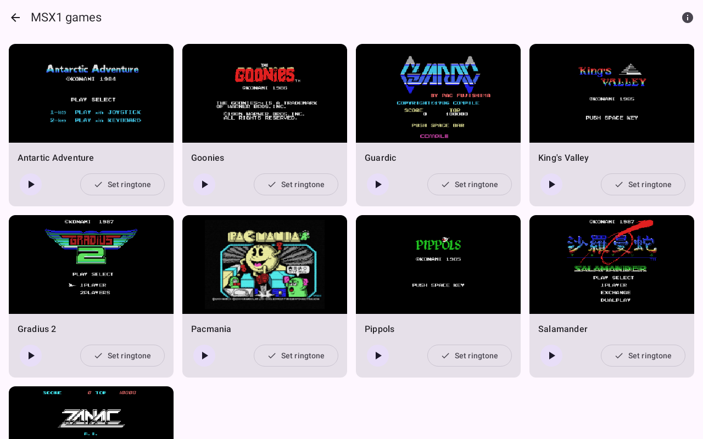

android-msxringtones
===============

Aplicação para Android - MSX Ringtones

**MSX Ringtones** is an Android app for listening to soundtracks from classic MSX1 and MSX2 games and setting one as your phone's ringtone. *PSG and FM-PAC for your ears.*

## Games

| MSX1 | MSX2 |
|---|---|
| Antartic Adventure | Aleste 2 |
| Goonies | Firehawk |
| Guardic | Fray |
| King's Valley | Golvellius |
| Gradius 2 | Metal Gear |
| Pacmania | SD Snatcher |
| Pippols | Treasure of USAS |
| Salamander | |
| Zanac | |

## Features

- Play any soundtrack, and set it as the default ringtone with one tap.
- Material 3 design, with Material You colors on Android 12+ and a dark theme.
- Adapts to phones, tablets and foldables, in portrait and landscape.
- Android 13+ themed icon, splash screen and predictive back gesture.

To set a ringtone, the app needs the **Modify system settings** permission. The first time you tap **Set ringtone**, the app opens that settings screen. When you come back, it finishes setting the ringtone.

## Privacy

The app collects no data and has no Internet permission. See the [privacy policy](PRIVACY.md).

## Requirements

- Android 6.0 (API 23) or newer.

## Screenshots

<p>
  
  
  
  
</p>

On tablets and in landscape, the game list shows more columns:



The screenshots are rendered from the app's real screens by a JVM screenshot test, with no device needed. To regenerate them after a UI change, run `./gradlew :app:recordRoborazziDebug`.

## Building

- **Built with:** Kotlin, Jetpack Compose and Material 3, as a single-activity app.
- **Toolchain:** Android Gradle Plugin 9.5, Gradle 9.9 (wrapper included) and Kotlin 2.4.
- **SDK levels:** compileSdk 37, targetSdk 36, minSdk 23.
- **Needs:** JDK 17 or newer, and the Android SDK. Set `ANDROID_HOME` or `sdk.dir` in `local.properties`.

```bash
./gradlew :app:assembleDebug        # debug APK: app/build/outputs/apk/debug/app-debug.apk
./gradlew :app:assembleRelease      # release (R8 + resource shrinking; sign with your own key)
./gradlew :app:testDebugUnitTest    # unit + screenshot tests
./gradlew :app:recordRoborazziDebug # regenerate screenshots/ (Roborazzi + Robolectric)
./gradlew :app:lint
```

### Adding a game

1. Put the audio file in `app/src/main/res/raw/<name>.ogg`.
2. Put the title-screen image in `app/src/main/res/drawable-hdpi/`.
3. Add one entry to the `MsxGame` enum in `app/src/main/java/com/olimposystems/android/MsxGame.kt`.

[AGENTS.md](AGENTS.md) has more detail on the project layout and conventions.

## Google Play

https://play.google.com/store/apps/details?id=com.olimposystems.android
